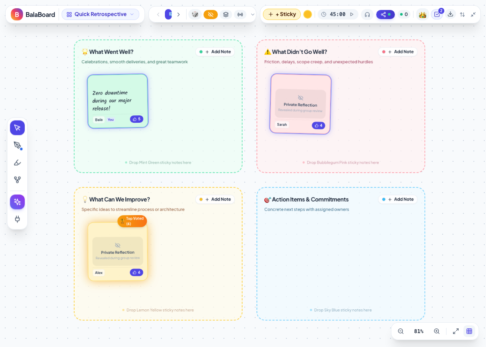
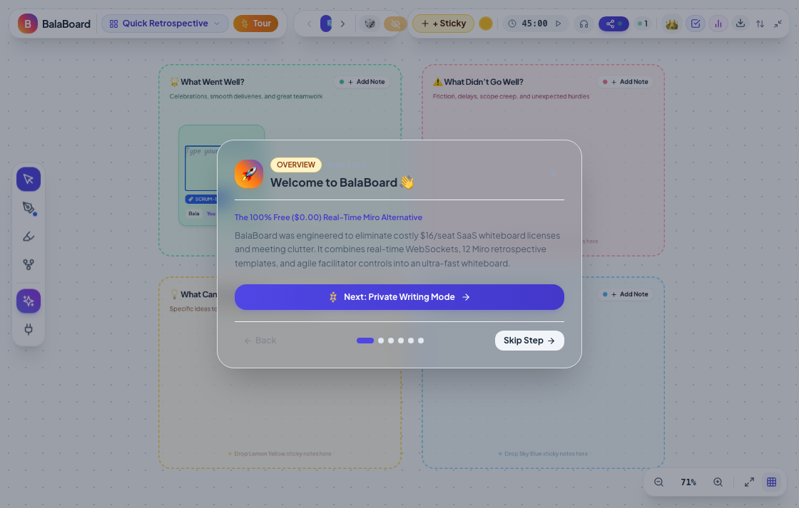
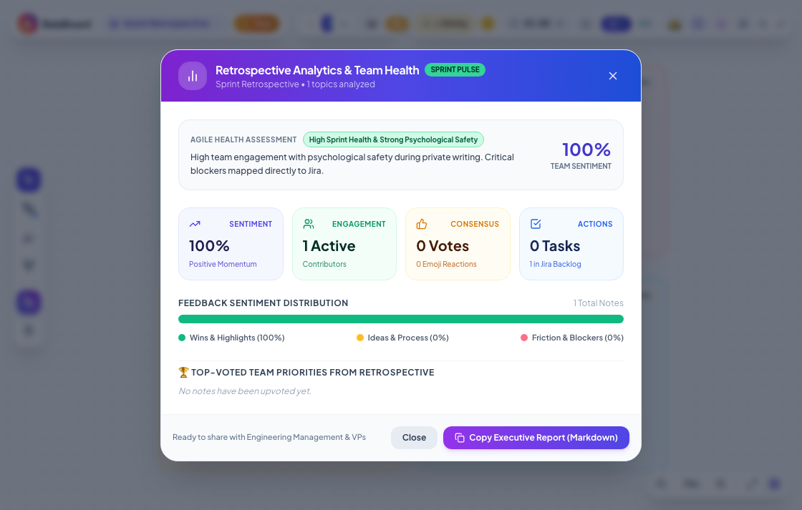
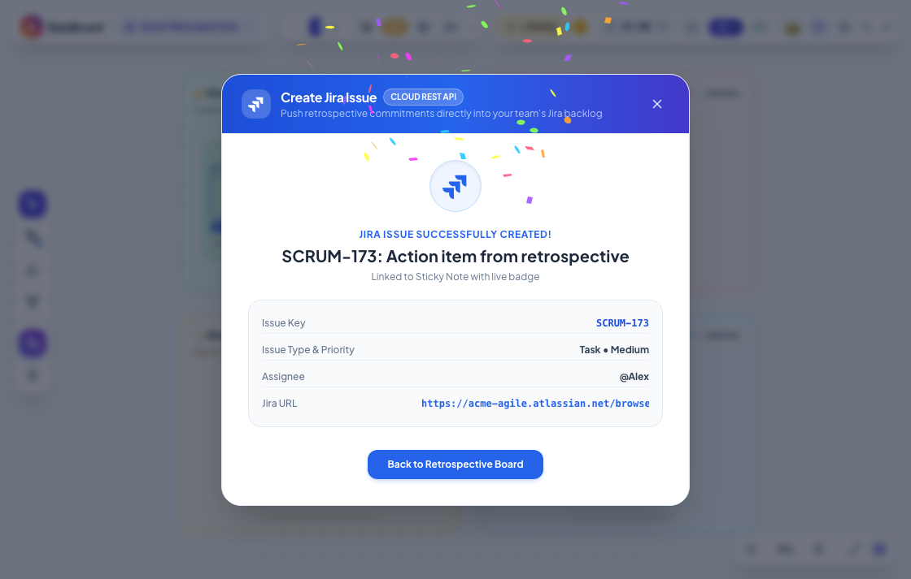
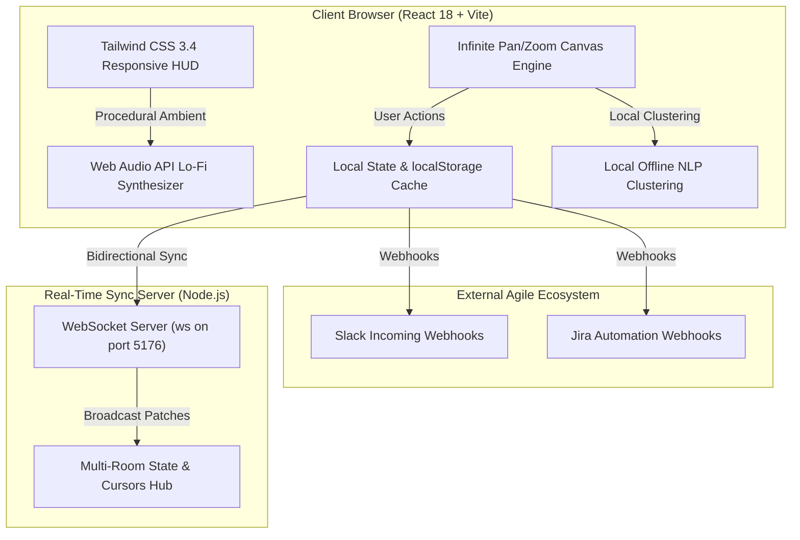

# 🌟 BalaBoard — Agile Retrospective Whiteboard

<div align="center">



### Modern, lightweight, real-time Miro alternative engineered for high-performing Agile teams.

[](https://balaboard.onrender.com)
[](https://reactjs.org/)
[](https://vitejs.dev/)
[](https://tailwindcss.com/)
[](https://developer.mozilla.org/en-US/docs/Web/API/WebSockets_API)
[](https://balaboard.onrender.com)
[](LICENSE)

<br/>

**[🚀 Launch Live Retrospective](https://balaboard.onrender.com)** • **[📖 Architecture](#️-architecture--tech-stack)** • **[⚡ Quick Start](#-quick-start)** • **[🎯 Features](#-key-features)** • **[🐳 Docker](#-docker-deployment)**

</div>

---

## 💡 Why BalaBoard?

Commercial collaborative whiteboard platforms like Miro, Mural, and MetroRetro are powerful but increasingly burdened by:
- **Costly Per-Seat Subscriptions:** Prohibitive pricing ($8–$16/user/month) for distributed software teams.
- **Cognitive Anchoring & Clutter:** Team members bias each other's ideas during retrospective brainstorming before reflection is complete.
- **Heavy Resource Footprint:** Bulky web apps that lag on 13" laptops and split screens.

**BalaBoard** was built from the ground up to solve these pain points. It is a **100% free ($0.00 infrastructure cost)**, ultra-responsive agile retrospective whiteboard featuring **private reflection masks**, **multiplayer WebSocket collaboration**, **12 curated Miro retrospective templates**, **dot voting**, **action item conversion**, and **offline-first AI theme clustering**.

---

## 🎯 Key Features

### 1. 📋 12 Miro-Inspired Agile Templates
Jump straight into structured retrospectives with pre-built interactive templates:
- **Quick Retrospective** (Went Well, Didn't Go Well, Can Improve, Actions)
- **Sailboat Retro** (Wind, Island Goals, Anchors, Reefs & Risks)
- **Starfish Retro** (Keep Doing, More Of, Less Of, Stop Doing, Start Doing)
- **Mad, Sad, Glad** (Emotional sentiment & blockers breakdown)
- **4Ls Retro** (Liked, Learned, Lacked, Longed For)
- **Rose, Thorn, Bud** (Highlights, Hurdles, Opportunities)
- **Mountain Climb** (Peak Goal, Climbing Ropes, Steep Cliffs, Gear Needed)
- **Hot Air Balloon** (Warm Air Boosters, Sunny Skies, Sandbags, Storm Clouds)
- **Start, Stop, Continue** (Agile classic momentum audit)
- **DAKI** (Drop, Add, Keep, Improve)
- **Plus / Delta (Δ)** (Continuous improvement matrix)
- **KALM** (Keep, Add, Less, More)

### 2. ⚡ Infinite Responsive Canvas & Dynamic Auto-Fit
- **Fluid Pan & Zoom:** Smooth hardware-accelerated navigation from 20% to 200%.
- **Zero-Overflow Responsive Layout:** Dynamically computes template bounding boxes to auto-fit any screen width — fully optimized for standard 13" laptop screens and macOS Arc Browser.
- **Dot Grid Background:** Subtle, clean visual reference with 1-click grid toggle.

### 3. 🤫 Private Reflection Writing Mode (Anti-Anchoring)
- Enables teammates to write raw, candid sticky notes independently without seeing others' feedback during the reflection phase.
- Scrum Masters can reveal all notes simultaneously with a single click once brainstorming concludes.

### 4. 🎨 Respective Column Color Matching
- Clicking **`+ Add Note`** directly on any column header automatically generates a sticky note with a color matching the column theme (e.g. *What Went Well* $\rightarrow$ **Mint Green**, *What Didn't Go Well* $\rightarrow$ **Bubblegum Pink**, *What Can We Improve* $\rightarrow$ **Lemon Yellow**).
- Color selector popover allows switching between 6 pastel palette colors at any time.

### 5. 🗳️ Dot Voting & Golden Trophy Badges
- Configurable vote allocation per teammate (default: 5 votes).
- Real-time vote tallying with animated celebration confetti.
- Automatically identifies and decorates highest-voted topics with an animated **🏆 Top Voted** badge.

### 6. 🤝 Real-Time Multiplayer Collaboration & Live Cursors
- Ultra-low latency WebSocket synchronization across tabs, browsers, and remote teammates.
- Broadcasts real-time remote cursor movements with teammate avatars and labels.
- Live online participant presence drawer with 1-click room link sharing.

### 7. 🎯 Action Items Drawer & 1-Click Conversion
- Turn any retro discussion note into a concrete, assignable action item with a single click.
- Assign owners, toggle completion status, and review active tasks without leaving the board.

### 8. 🧠 Offline-First AI Retrospective Intelligence
- **Smart Theme Clustering:** Automatically analyzes sticky notes using heuristic TF-IDF and local keyword clustering to group feedback into semantic themes.
- **Smart Action Item Generation:** Extracts actionable, concrete commitments directly from team sentiment notes without external API keys or cloud costs.
- Fully compatible with local **Ollama** LLMs for privacy-first teams.

### 9. 🎧 Ambient Lo-Fi Audio & Sound Effects
- Built-in procedural ambient focus music designed for calm, productive reflection sessions.
- Tactile sound effects for timer alerts, sticky note placement, phase progression, and celebration confetti.

### 10. 📡 Facilitator Spotlight Mode
- Allows the Scrum Master to "Spotlight" and broadcast their canvas zoom and pan coordinates, gently pulling all participants' viewports to the facilitator's focus.

### 11. 🔔 Webhook Integrations Hub (Slack & Jira)
- Dispatch retro summaries and newly assigned action items directly to Slack channels or Jira webhooks with a single click.

### 12. 💾 Multi-Format Export
- **PNG Snapshot:** High-resolution image export of the entire whiteboard canvas.
- **Markdown Minutes:** Clean meeting minutes formatted for Notion, Confluence, or GitHub wikis.
- **JSON Backup:** Complete board state backup for archive and restore.

### 13. 📱 Adaptive Floating Island Navigation (Zero Overlap)
- **Top or Bottom Docking:** Dock the navigation toolbar to the top or bottom of the screen with automatic HUD offset adjustment.
- **Slim Minimized Mode:** Collapse all controls into a compact, non-intrusive floating pill.

### 14. 🎫 Direct Jira Cloud Issue Creation & Live Badging
- Push any retrospective sticky note or action item directly into your team's Jira backlog.
- Pre-fills rich retrospective metadata: Meeting Title, Framework, Author, Upvotes, and Acceptance Criteria.
- Supports Project Keys (`SCRUM`, `KAN`, `AGILE`, `ENG`), Issue Types (`Task`, `Story`, `Bug`, `Spike`), and Priorities.
- Attaches an interactive, live Atlassian Jira badge (`[Jira] SCRUM-173 ↗`) with direct ticket links.
- Interactive sandbox mode enabled so interviewers and teammates can test the Jira workflow live without enterprise credentials.

### 15. ⚡ 60-Second Interactive Guided Tour
- One-click interactive tour engineered for recruiters, hiring managers, and new team onboarding.
- Smoothly auto-pans, auto-zooms, and demonstrates the core agile workflow step-by-step: private reflection, simultaneous reveals, AI theme clustering, dot voting, and Jira issue creation.

### 16. 📊 Retrospective Analytics & Team Health Dashboard
- Computes real-time team metrics: Sentiment Index, active contributor ratios, consensus votes, and backlog commitment conversion.
- Visual sentiment distribution bar (Celebrations vs. Ideas vs. Friction).
- 1-click export of an Executive Markdown Report tailored for Engineering Directors, VPs, and Slack/Confluence digests.

<br/>

<div align="center">

| 60s Guided Demo Tour | Team Health Analytics | Direct Jira Integration |
|:---:|:---:|:---:|
|  |  |  |

</div>

</div>

---

## ⚡ Quick Start

### Prerequisites
- [Node.js](https://nodejs.org/) (v18.0 or newer)
- npm or yarn

### 1. Clone & Install
```bash
git clone https://github.com/layyzee/balaboard.git
cd balaboard
npm install
```

### 2. Launch Development Server
```bash
# Start both Vite frontend (port 5175) and WebSocket sync server (port 5176):
./start.sh
```

Or run them individually:
```bash
# Terminal 1: Frontend
npm run dev

# Terminal 2: Real-Time Sync Server
npm run sync
```

Open **`http://localhost:5175`** in your browser.

---

## 🐳 Docker Deployment

Run BalaBoard anywhere with zero configuration using Docker:

```bash
# Build the production image
docker build -t balaboard:latest .

# Run the container
docker run -d -p 5175:5175 -p 5176:5176 --name balaboard balaboard:latest
```

Access BalaBoard at `http://localhost:5175`.

---

## ☁️ Zero-Cost Cloud Deployment

BalaBoard is architected to operate at **$0.00/month** on free-tier cloud platforms.

### Deploy to Render
The repository includes a ready-to-use [`render.yaml`](render.yaml) blueprint:
1. Connect your GitHub repository to [Render](https://render.com).
2. Create a new **Blueprint Instance** pointing to `render.yaml`.
3. Render automatically builds the production SPA with free global CDN hosting.

### Deploy to Vercel
The repository includes a [`vercel.json`](vercel.json) single-page application configuration:
```bash
npm install -g vercel
vercel deploy --prod
```

---

## ⌨️ Keyboard Shortcuts

| Shortcut | Action |
|---|---|
| `Space` + **Drag** | Pan across infinite canvas |
| `Ctrl` / `Cmd` + **Scroll** | Smooth zoom in / zoom out |
| `Ctrl` / `Cmd` + `0` | Reset zoom to 100% |
| **Double Click** Canvas | Create a new sticky note at cursor position |
| `Delete` / `Backspace` | Delete selected sticky note |
| `Esc` | Cancel connecting line or close open modal |

---

## 🏗️ Architecture & Tech Stack



- **Frontend Framework:** React 18 with modern React Hooks (`useCallback`, `useRef`, `useState`, `useEffect`)
- **Build Tool:** Vite 5 (sub-second HMR and optimized production bundling)
- **Styling:** Tailwind CSS 3.4 with custom glassmorphism and pastel palettes
- **Real-Time Communication:** Native WebSocket protocol (`ws`) with room isolation
- **Icons & Typography:** Lucide React, Plus Jakarta Sans, Kalam handwriting font
- **Celebration & Audio:** Canvas-Confetti, Web Audio API procedural synthesis

---

## 👥 Facilitation Roles

Switch roles instantly from the profile switcher in the top bar:
- 👑 **Bala (Scrum Master):** Full facilitation control — timer management, spotlight broadcasting, note reveal, and phase transitions.
- 🎨 **Alex (Frontend Lead):** Active contributor, voter, and action item assignee.
- ⚙️ **Sarah (Backend Lead):** Active contributor and technical debt reporter.
- 🔍 **David (QA Lead):** Quality metrics and release retrospective owner.
- 🚀 **Emma (Product Manager):** Feature delivery and customer feedback advocate.

---

## 📄 License

This project is licensed under the **MIT License** — feel free to use it, customize it, and deploy it for your teams!

---

<div align="center">

Crafted with 💙 by **[Balaji (@layyzee)](https://github.com/layyzee)**

**[⭐ Star this repository on GitHub](https://github.com/layyzee/balaboard)** if you find it helpful for your agile retrospectives!

</div>
