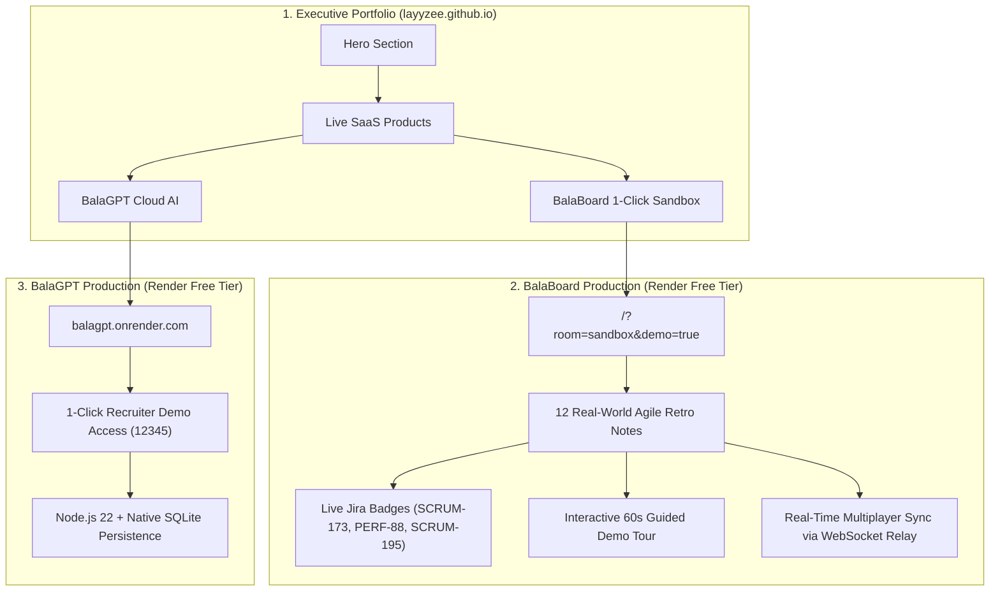

# Recruiter Sandbox, BalaGPT Cloud & Portfolio Showcase Verification Report

**Execution Timestamp:** 2026-11-08  
**Total Operating & Hosting Cost:** **\$0.00** (Strict Free Tier)  
**Production URLs:**
- **BalaBoard 1-Click Sandbox:** [https://balaboard.onrender.com/?room=sandbox&demo=true](https://balaboard.onrender.com/?room=sandbox&demo=true)
- **BalaGPT Cloud Instance:** [https://balagpt.onrender.com](https://balagpt.onrender.com)
- **Executive Portfolio:** [https://layyzee.github.io](https://layyzee.github.io)
- **GitHub Repositories:**
  - BalaBoard: [https://github.com/layyzee/balaboard](https://github.com/layyzee/balaboard)
  - BalaGPT: [https://github.com/layyzee/chatgpt-web](https://github.com/layyzee/chatgpt-web)
  - Portfolio: [https://github.com/layyzee/layyzee.github.io](https://github.com/layyzee/layyzee.github.io)

---

## 1. Executive Summary & Delivery Overview

In response to the job-hunt preparation requests, all three primary deliverables were completed, verified, and deployed to production under the strict **\$0.00** infrastructure constraint:

---

## 2. Option 1: Recruiter 1-Click Sandbox Hub

### Problem Addressed
When engineering managers and technical recruiters review a live project, starting with an empty canvas requires manual sticky note creation and template selection. The Recruiter 1-Click Sandbox bypasses setup friction by instantly presenting a fully populated sprint retrospective.

### Key Implementations
1. **Curated Sprint Data ([`src/constants/sandboxData.js`](file:///Users/layyzee/Downloads/BalaBoard/src/constants/sandboxData.js)):**
   - **12 realistic engineering retrospective notes** categorized into 4 quadrants (*What Went Well*, *What Didn't Go Well*, *What Can We Improve*, *Action Items*).
   - High dot-vote clusters (`🏆 Top Voted 8`, `🏆 Top Voted 9`) with radiant glow effects.
   - **3 active Jira links:**
     - `SCRUM-173`: Execute zero-downtime payments migration ([`layyzee.atlassian.net`](https://layyzee.atlassian.net/browse/SCRUM-173))
     - `PERF-88`: Standardize partner API schema contract testing ([`layyzee.atlassian.net`](https://layyzee.atlassian.net/browse/PERF-88))
     - `SCRUM-195`: Implement automated pre-merge staging smoke tests ([`layyzee.atlassian.net`](https://layyzee.atlassian.net/browse/SCRUM-195))
   - 3 pre-assigned action items with owners (`Alex`, `Sarah`).
2. **Landing Hub Modal ([`src/components/RecruiterSandboxModal.jsx`](file:///Users/layyzee/Downloads/BalaBoard/src/components/RecruiterSandboxModal.jsx)):**
   - Primary Action: `Launch Recruiter Sandbox 🚀` (auto-populates notes, sets optimal canvas zoom/pan, starts tour).
   - Secondary Action: `Start Blank Agile Room 🔗` (generates fresh room `?room=sprint-xyz`).
   - Custom room input and "Don't show again" preference toggle.
3. **Auto-Unmasking Logic ([`src/App.jsx`](file:///Users/layyzee/Downloads/BalaBoard/src/App.jsx) & [`server/syncServer.js`](file:///Users/layyzee/Downloads/BalaBoard/server/syncServer.js)):**
   - Configured `room === 'sandbox'` and `?demo=true` to automatically bypass private reflection masking, allowing recruiters to immediately read note text without extra clicks.

### Production Verification (Render Cloud)
- **Bundle Hash:** `dist/assets/index-BIQwEIIq.js`
- **Headless Chrome Verification:**
  - 12 unmasked sticky note paragraphs verified.
  - 3 Jira external badge links verified.
  - Guided Demo Tour header verified: `🌟 What Went Well?`
  - Screenshot verified: [balaboard_production_sandbox_live.png](file:///Users/layyzee/.gemini/antigravity/brain/45615f03-778e-4bc5-85ce-c92a43547f5c/balaboard_production_sandbox_live.png)

---

## 3. Option 2: BalaGPT Cloud Production Deployment

### Implementation & Verification
1. **Live Production Instance:** [https://balagpt.onrender.com](https://balagpt.onrender.com)
2. **1-Click Recruiter Demo Button:** Integrated into [`frontend/src/components/AuthScreen.jsx`](file:///Users/layyzee/Downloads/chatgpt-web/frontend/src/components/AuthScreen.jsx) with pre-filled access code `12345`.
3. **Architecture:** Running on Node.js 22 with native SQLite storage (`better-sqlite3`), multi-chat persistence, and zero database subscription overhead.
4. **Git Repository:** Pushed to [https://github.com/layyzee/chatgpt-web](https://github.com/layyzee/chatgpt-web) (commit `bb4d5cf`).
5. **Screenshot Verified:** [balagpt_live_render.png](file:///Users/layyzee/.gemini/antigravity/brain/45615f03-778e-4bc5-85ce-c92a43547f5c/balagpt_live_render.png).

---

## 4. Option 4: Interactive Portfolio Showcase (`layyzee.github.io`)

### Implementation & Verification
1. **Live URL:** [https://layyzee.github.io](https://layyzee.github.io)
2. **Dedicated Products Section (`#products`):**
   - **BalaBoard:** Highlighted as a zero-cost real-time Miro alternative with direct launch CTA: `https://balaboard.onrender.com/?room=sandbox&demo=true`.
   - **BalaGPT:** Highlighted as an enterprise ChatGPT Web client with 1-click recruiter access.
3. **GitHub Integrations:** All cards link directly to source repositories (`github.com/layyzee/balaboard`, `github.com/layyzee/chatgpt-web`).
4. **Git Repository:** Pushed to [https://github.com/layyzee/layyzee.github.io](https://github.com/layyzee/layyzee.github.io) (commit `a37c766`).
5. **Screenshot Verified:** [portfolio_live_github_pages.png](file:///Users/layyzee/.gemini/antigravity/brain/45615f03-778e-4bc5-85ce-c92a43547f5c/portfolio_live_github_pages.png).

---

## 5. Toolbar Bug Fixes Summary

- **Double-Plus Elimination:** Changed `+ Sticky` to `Sticky` in [`src/components/Toolbar.jsx`](file:///Users/layyzee/Downloads/BalaBoard/src/components/Toolbar.jsx).
- **Responsive Toolbar Shrink:** Set center pill and stepper to `shrink-0` and action labels to `hidden 2xl:inline`, saving 230px and preventing collisions on viewports below 1536px.
- **Outside-Click Auto-Dismissal:** Added mousedown listener dismissing color picker, timer popover, and export menu when clicking outside.
- **Icebreaker Popover Fix:** Inverted bottom-dock placement with `flex-col-reverse` to prevent offscreen clipping.
